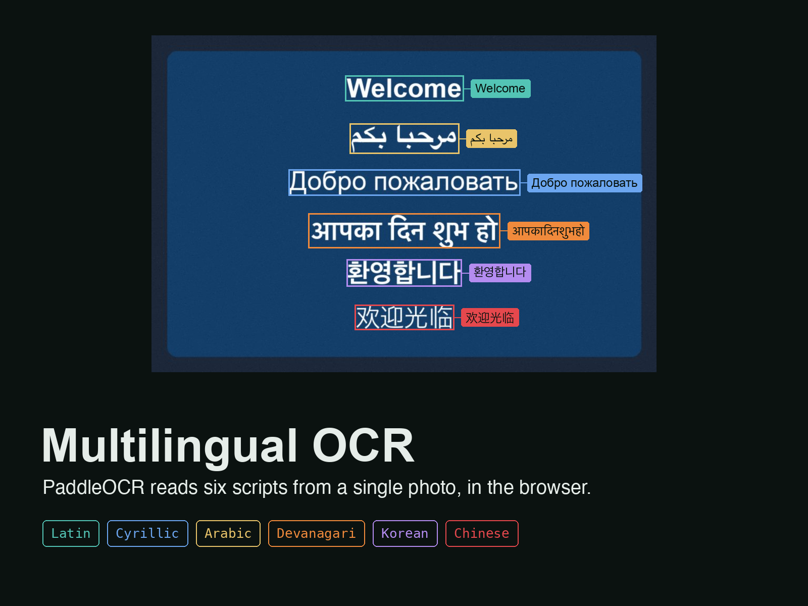
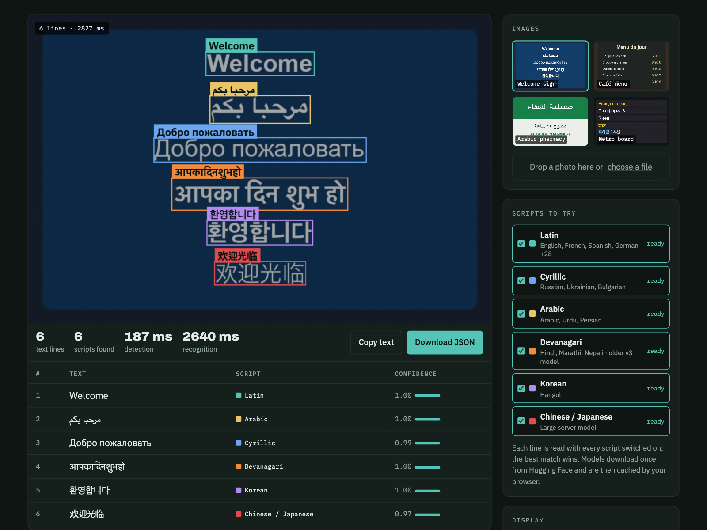

# Multilingual OCR

Read text in six scripts from a single photo: Latin, Cyrillic, Arabic, Devanagari, Korean and Chinese. Built on PaddleOCR models running in your browser, so images are never uploaded.

**[Try the live demo](https://hamzaasyf.github.io/multilingual-ocr/)**



## Features

- **Mixed-language images:** each text line is read by every enabled script model, and the most confident reading is kept, so there's no need to choose a language first
- **Right-to-left text:** Arabic is put back into correct reading order, and Eastern Arabic numerals are kept
- **Hindi fixes:** vowel signs are moved to the right position
- **Structured output:** text, detected script, confidence and box coordinates, exportable as JSON
- **Private:** runs locally with ONNX Runtime Web



## How it works

1. **Detect:** a PP-OCRv3 DB detector finds every text line in the photo.
2. **Recognise:** each line is resized to 48 px high and read by PaddleOCR recognisers (PP-OCRv5 for Latin, Cyrillic, Korean and Chinese; PP-OCRv3 for Arabic and Hindi) with CTC decoding.
3. **Pick the script:** confidence and text coverage decide which reading is kept.
4. **Fix the order:** right-to-left and Devanagari post-processing.
5. **Export:** JSON with text, script, confidence and boxes.

## Run it locally

Serve the folder with any static server:

```bash
python -m http.server 8000
# then open http://localhost:8000
```

The OCR models are downloaded from Hugging Face on first use and cached by the browser.

## Known limitations

Hindi uses PaddleOCR's older v3 model, which can drop spaces and miss some half-letters.

## Tech

- [PaddleOCR](https://github.com/PaddlePaddle/PaddleOCR) models (Apache-2.0), ONNX versions from [monkt/paddleocr-onnx](https://huggingface.co/monkt/paddleocr-onnx)
- [ONNX Runtime Web](https://onnxruntime.ai/)
- Plain HTML, CSS and JavaScript

## Use cases

Reading signs, menus and labels for translation, digitising multilingual documents, and extracting text from product photos.

## About

Built by [Muhammad Hamza Asif](https://www.linkedin.com/in/hamzaasyf/), AI engineer working on computer vision, speech AI and LLM applications. Need OCR or document AI for your workflow? [Get in touch on LinkedIn](https://www.linkedin.com/in/hamzaasyf/).

## Licence

Code: MIT. PaddleOCR models: Apache-2.0.
